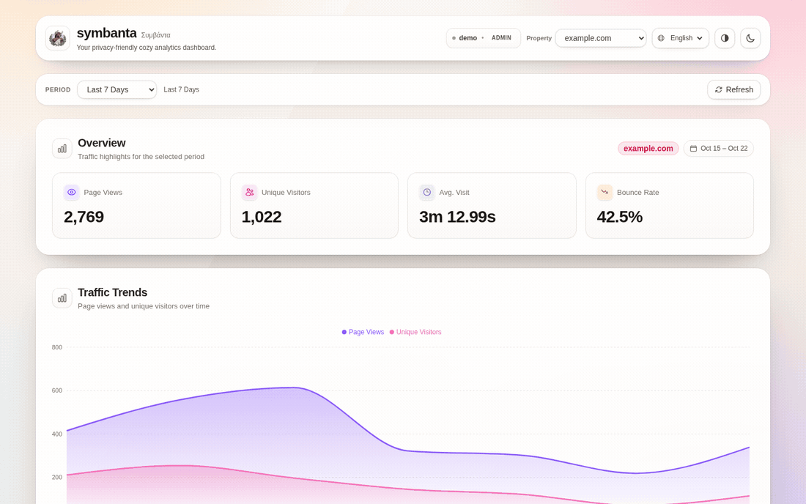
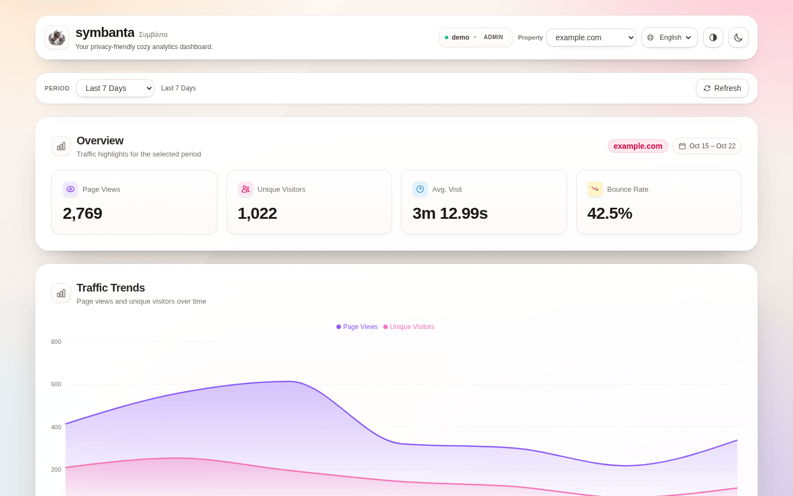
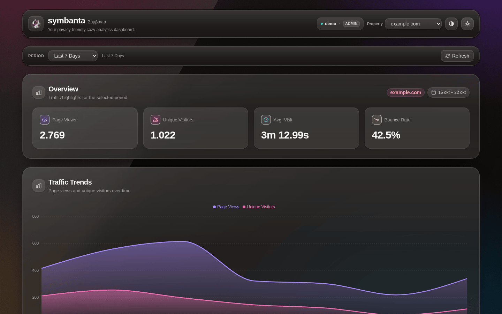

#+title: symbanta · Συμβάντα — the cozy, privacy-friendly analytics dashboard
#+author: Josep Bigorra
#+email: jjbigorra@gmail.com
#+language: en
#+options: toc:nil num:nil

[[https://jointhefreeworld.org/ggg/dist/license-agpl3+.svg]]    [[https://jointhefreeworld.org/ggg/dist/license-fdl13+.svg]]    [[https://img.shields.io/badge/tests-183_passing-6f42c1.svg]]    [[https://img.shields.io/badge/WCAG_2.1-AA-2ea44f.svg]]    [[https://img.shields.io/badge/development-no_backend_needed-ff69b4.svg]]    [[https://img.shields.io/badge/stack-React_19_+_Vite_8_+_Tailwind_4-38bdf8.svg]]

#+begin_quote
*Symbanta* is the dashboard for the [[https://codeberg.org/jjba23/symbanta][symbanta analytics core]]: a fast, beautifully frosted interface that answers one question — /what happened on my site, and is it getting better?/ — without ads, without visitor profiles, and without a single byte of personal data leaving your server.
#+end_quote

#+caption: Eight seconds inside the dashboard, entirely served by the bundled mock API: hover the traffic curve for a glass tooltip, scroll past the sticky filter bar, widen the reporting period to 30 days, flip to the dusk theme, and turn on the high-contrast material.

* In a hurry?

- *What it is* :: a single-page analytics dashboard (React 19 + Vite + TailwindCSS 4) that visualises the metrics of a symbanta core instance: page views, visitors, bounce rate, average visit, traffic trends, routes, screen sizes, countries, user agents, custom events, console logs and the event-type registry.
- *Who it is for* :: anyone who runs [[https://codeberg.org/jjba23/symbanta][symbanta]] and wants insight without surveillance — personal sites, small co-ops, public-interest projects, and anyone who thinks analytics should feel calm.
- *Why you will like it* :: it needs *no backend* to develop against, it is tested against *WCAG 2.1 AA* by machine-checked rules rather than good intentions, and it looks like light falling through frosted glass instead of a wall of dashboards.

#+begin_src sh
git clone https://codeberg.org/jjba23/symbanta-dashboard.git
cd symbanta-dashboard
npm install && npm run dev     # → http://localhost:5173 (demo data, no backend)
#+end_src

That is the whole onboarding. Everything below is detail, and all of it is optional.

----------------

#+toc: headlines 2

----------------

* Why another analytics dashboard?

Symbanta is a privacy-friendly, free and open-source software analytics platform.

It tries to inspire a return to what measurement should be: tracking *what happened so as to improve user experience and reliability*, not for profit and selling customized ads to people.

Symbanta (Greek: *Συμβάντα*, singular *Συμβάν* / *Symban*) originates from the Ancient Greek verb /συμβαίνω/ (/sumbainō/), a compound of /syn-/ ("together") and /bainō/ ("to step or walk"). It translates to: /events, occurrences, or happenings/.

The dashboard is the calm end of that idea: numbers you can read in one breath, a period you pick once, and a design that gets out of the way.

- *The core of symbanta and its API* lives here: [[https://codeberg.org/jjba23/symbanta]]
- *This repository* is the dashboard that talks to it.

Built with [[https://react.dev][React]], [[https://vite.dev][Vite]], [[https://tailwindcss.com][TailwindCSS]], [[https://tanstack.com/query][TanStack Query]], [[https://orval.dev][Orval]] + OpenAPI, and [[https://recharts.org][Recharts]].

* Features

** The numbers you actually need, and nothing else

- *Overview cards* — page views, unique visitors, average visit duration and bounce rate for the selected property and period.
- *Traffic trends* — a smooth area chart with page views and unique visitors, bucketed hourly or daily depending on the period you choose.
- *Breakdowns that earn their space* — top routes, screen sizes, countries, user agents, and event occurrences, each in a responsive table with share bars that fold away gracefully on narrow screens.
- *Console logs as diagnostics, not noise* — the console output forwarded by your instrumented apps, newest first, filterable by severity and capped at 50–500 entries.
- *Event-type registry* — declare the custom event names your application emits, with idempotent registration, so the payloads and the dashboard agree on spelling.

** One filter bar to rule them all

- A *single sticky period selector* (today, yesterday, last 24 hours, 3/7/30 days, this/last month, 6/12 months, this/last year, all time) drives every panel at once.
- The chosen *property* is remembered in a cookie; the first available property is selected automatically.
- *Refresh* invalidates every query and announces progress politely to assistive technology.
- Everything is cached, retried and refetched by [[https://tanstack.com/query][TanStack Query]], so wandering between periods feels instant.

** A dashboard that looks hand-crafted

- A *four-layer glass material* — wallpaper, translucent body, specular sheen, hairline rim — with multi-layer shadows instead of flat borders.
- A *denser sticky bar* that stays legible while tables scroll beneath it (deliberately, and enforced by a test).
- *Golden-hour wallpaper, film grain and sprung easing*, because motion should feel like a physical object settling, not a CSS demo.
- Light, dark and an explicit *increase-contrast* material, all shareable through one icon each.

** Accessible by construction

- Targets *WCAG 2.1 AA* with a machine-checked colour contract, structural audits and [[https://github.com/dequelabs/axe-core][axe-core]] running over the real component tree.
- *Skip link*, one =<h1>=, named regions, focusable scroll containers, captions and scoped headers on every table.
- *Charts expose a visually hidden data table*, so the same story is available to screen readers.
- Honours =prefers-reduced-motion=, =prefers-reduced-transparency=, =prefers-contrast= and =forced-colors=.

** Develop offline, forever

- A *deterministic mock API* ships in =mock-api/= and mounts itself in the Vite dev server: =npm run dev= and you have data.
- Simulate latency, failures (=401=, =500=) and empty datasets with one environment variable each.
- A *standalone server* (=npm run mock:api=) serves the same router on its own port when you want the API next to a production build.

** Typed end to end, tested like it matters

- The API client is *generated by Orval* from the core's OpenAPI document, so types and hooks follow the backend automatically.
- *183 tests across 15 files*, including the WCAG maths, the mock router, and a full-dashboard accessibility pass.
- Tests gate deployment: CI refuses to build or publish when the suite fails.

* Visual tour

#+begin_quote
The GIF at the top is recorded against the bundled mock API — the numbers are deterministic demo data seeded by =domain + period=, not a real site.
#+end_quote

#+attr_html: :width 100%
#+caption: The golden-hour light material.

#+attr_html: :width 100%
#+caption: The dusk material, same dashboard, one click of the moon icon away.

/Both screenshots are *1440×900* captures of the real application, not mock-ups. Doc assets live in =docs/=./

* Installation

** Requirements

- *Node.js* =^20.19.0= or =>=22.12.0= (the versions Vite 8 supports) and npm 10 or newer.
- A modern browser with =backdrop-filter= support for the full effect; browsers without it fall back to opaque panels instead of muddy ones.
- *Optional but recommended*: [[https://nixos.org][Nix]] with flakes enabled — the repository ships a =flake.nix= that pins Node and the language servers.
- *No backend required* for development. A symbanta core instance is only needed when you want real data.

** With Nix (recommended, matches CI exactly)

#+begin_src sh
git clone https://codeberg.org/jjba23/symbanta-dashboard.git
cd symbanta-dashboard
nix develop            # Node, TypeScript LSP, prettier on PATH
npm install
npm run dev            # → http://localhost:5173
#+end_src

The dev shell also puts =node_modules/.bin= on your =PATH=, so =vite=, =vitest=, =oxlint= and =oxfmt= are always the pinned local versions.

** With Node.js directly

#+begin_src sh
git clone https://codeberg.org/jjba23/symbanta-dashboard.git
cd symbanta-dashboard
npm install
npm run dev
#+end_src

Then open [[http://localhost:5173][http://localhost:5173]]. You should land on the dashboard with the demo property =example.com= already selected, seven days of traffic, and a full set of breakdowns.

** Pointing the dashboard at a real API

The client is generated against =https://api.symbanta.jointhefreeworld.org=. For production nothing needs to be configured, but any other deployment can be re-rooted at runtime:

#+begin_src sh
# any deployment of the symbanta core
VITE_API_BASE_URL=https://analytics.example.org npm run dev

# or the standalone mock, in another terminal
npm run mock:api
VITE_API_BASE_URL=http://127.0.0.1:8787 npm run dev
#+end_src

The rewrite happens in =src/api/custom-fetch.ts=, so the Orval-generated client is never patched by hand. Requests are always sent with =credentials: "include"= — the session cookie set by the core's =POST /auth/login= is what authenticates you.

#+begin_quote
*CORS note.* If the API lives on another origin, that origin must allow credentials for your dev host. The bundled mock does this for you; a real core deployment may need adjusting.
#+end_quote

* Quick start (under a minute)

1. =npm install= — pull React, Vite, Tailwind, Recharts, Vitest and friends.
2. =npm run dev= — start Vite *and* the mock API (mounted at =/mock-api=).
3. Open =http://localhost:5173=, then try:
   - change *Period* → every panel refetches with the new window;
   - hover the traffic curve → a glass tooltip with the exact bucket;
   - click the *half-circle icon* → increase contrast;
   - click the *moon/sun icon* → dark mode, remembered next visit;
   - switch *Property* → the same dashboard for another demo domain.

Nothing to sign in to, nothing to seed, no database. When you are ready to see your own data, point =VITE_API_BASE_URL= at your core instance.

* Configuration

** Environment variables

| Variable              | Default        | What it does                                                            |
|-----------------------+----------------+-------------------------------------------------------------------------|
| =VITE_API_BASE_URL=   | (unset → prod) | Re-roots the generated absolute API URLs. =.env.development= sets it to =/mock-api=. |
| =MOCK_API_LATENCY_MS= | =120=          | Artificial latency so loading skeletons are visible while developing.   |
| =MOCK_API_FAULT=      | (unset)        | Answer every data route with this status (=401=, =500=, …) for error-state work. |
| =MOCK_API_EMPTY=      | (unset)        | =1= serves well-formed but empty datasets, for empty-state work.        |
| =MOCK_API_PORT=       | =8787=         | Port of the standalone mock server (=npm run mock:api=).                |
| =MOCK_API_HOST=       | =127.0.0.1=    | Bind address of the standalone mock server.                             |

Examples:

#+begin_src sh
MOCK_API_LATENCY_MS=1200 npm run dev     # enjoy the skeletons
MOCK_API_FAULT=500 npm run dev           # every panel shows its error state
MOCK_API_EMPTY=1 npm run dev             # every panel shows its empty state
MOCK_API_FAULT=401 npm run dev           # watch the login redirect happen
#+end_src

** Remembered state (cookies)

The dashboard stores only interface preferences — never analytics data:

| Cookie                      | Contents                                        |
|-----------------------------+-------------------------------------------------|
| =symbanta_theme=            | =light=, =dark= or =system= (with =localStorage= as fallback). |
| =symbanta_contrast=         | =system= or =more= — the "increase contrast" toggle. |
| =symbanta_selected_domain=  | The property currently being viewed.            |

The theme is applied before the first paint (see =src/main.tsx=), so navigating never flashes the wrong colour scheme.

** npm scripts

| Script                 | What it does                                                        |
|------------------------+---------------------------------------------------------------------|
| =npm run dev=          | Vite dev server *with* the mock API mounted at =/mock-api=.          |
| =npm run build=        | Type-check the whole project, then build =dist/=.                    |
| =npm run preview=      | Serve the production build. The mock API is mounted too, but =dist/= keeps the base URL it was *built* with — rebuild with =VITE_API_BASE_URL=/mock-api= to preview against demo data. |
| =npm run typecheck=    | =tsc -b= across the app and the tooling projects.                    |
| =npm test=             | The full Vitest suite, once.                                        |
| =npm run test:watch=   | Vitest in watch mode while you work.                                |
| =npm run test:coverage=| Coverage report (v8).                                               |
| =npm run test:a11y=    | Only the accessibility and contrast suites.                         |
| =npm run test:api=     | Only the mock-API router tests.                                     |
| =npm run mock:api=     | Standalone mock API on =http://127.0.0.1:8787=.                     |
| =npm run lint=         | Format with =oxfmt=, then lint and autofix with =oxlint=.           |
| =npm run api-gen=      | Regenerate =src/api/= from the core's OpenAPI document via Orval.    |

** Theming tokens

Every colour, blur, shadow and easing curve lives in the token block at the top of =src/index.css=. There are no ad-hoc hex values in components, and =src/a11y/tokens.ts= mirrors the materials so the contrast suite can measure them. If you want a different mood, that is the one file to edit.

* What the dashboard covers

The dashboard consumes the API of the symbanta core (the generated client in =src/api= is produced by Orval from its OpenAPI document with =npm run api-gen=):

- *summary* (=GET /v1/stats/summary=): page views, visitors, bounce rate and average active duration.
- *time series* (=GET /v1/stats/timeseries=): hourly or daily buckets rendered as a chart.
- *events* (=GET /v1/stats/events=): occurrences and visitors per event name, custom events included.
- *routes*, *screen sizes*, *countries* and *user agents* (=GET /v1/stats/...=): breakdown tables.
- *console logs* (=GET /v1/logs=): console output forwarded by instrumented applications, filterable by level and limit.
- *event types* (=GET /v1/event-types=, =POST /v1/event-types=): registry of the event names an application emits.

Authentication uses the session cookie set by =POST /auth/login=; the selected domain and period are remembered in cookies.

* The glass design system

The interface is built as a macOS-style layered glass system (see the token block at the top of =src/index.css=). Every surface is composed of four layers — wallpaper, translucent body, specular sheen and a hairline rim — in two material sets:

- *.glass* — panels, popovers and chart tooltips.
- *.glass-toolbar* — the title bar and the *sticky filter bar*. This one is deliberately *denser* (≈0.92–0.98 alpha in light mode, ≈0.90–0.94 in dark mode) so table rows scrolling underneath never bleed through the controls. =src/a11y/tokens.test.ts= reads the stylesheet and fails if the toolbar ever becomes more transparent than the panels.
- *.glass-inset* / *.glass-control* / *.glass-lift* — nested tiles, push buttons/pop-ups and the hover lift used by the stat cards.
- *Motion* uses sprung easing tokens (=--ease-spring=, =--ease-glide=) and collapses entirely under =prefers-reduced-motion=.

* Local development without a backend

=mock-api/= contains a dependency-free, in-memory implementation of the API with deterministic demo analytics (seeded by =domain + period=, so the numbers are stable across reloads).

#+begin_src sh
npm install
npm run dev        # http://localhost:5173 — API mounted at /mock-api
#+end_src

How it works:

- =mock-api/plugin.ts= mounts the router as Vite middleware at =/mock-api= (dev *and* preview).
- =.env.development= sets =VITE_API_BASE_URL=/mock-api=; =api/custom-fetch.ts= re-roots the absolute URLs produced by Orval onto that base, so the generated client is never patched or regenerated for local work.
- =mock-api/server.ts= runs the same router standalone (Node's native TypeScript support, no build step, no dependencies):

#+begin_src sh
npm run mock:api                                     # http://127.0.0.1:8787
VITE_API_BASE_URL=http://127.0.0.1:8787 npm run dev
#+end_src

Useful switches (environment variables, read by both entry points):

| Variable              | Effect                                                             |
|-----------------------+--------------------------------------------------------------------|
| =MOCK_API_LATENCY_MS= | Artificial latency, so loading skeletons are visible (default 120) |
| =MOCK_API_FAULT=      | Answer every data request with this status (e.g. =401=, =500=)     |
| =MOCK_API_EMPTY=      | =1= serves empty datasets, for empty-state work                    |
| =MOCK_API_PORT=       | Port for the standalone server (default 8787)                      |

Routes covered: =/auth/me=, =/auth/login=, =/auth/logout=, =/v1/properties=, every =/v1/stats/*= breakdown, =/v1/logs= (level + limit filters), =/v1/event-types= (GET and idempotent POST), =/v1/events/register= and =/health=. Failures use RFC 7807 problem details, exactly like the real API.

** Anatomy of the mock

- =mock-api/fixtures.ts= — the seeded PRNG and the dataset builder: a gentle weekly wave for the chart, long-tail breakdowns that add up to the summary total, plausible console logs, and event types per domain.
- =mock-api/routes.ts= — a pure router: =handle(method, url, body)= returns ={ status, headers, body }=. No sockets, no globals, trivially testable.
- =mock-api/http.ts= — the thin Node glue (body reading, JSON serialisation, optional CORS).
- =mock-api/plugin.ts= / =mock-api/server.ts= — the two ways to run it (Vite middleware, standalone HTTP).

Because the router is pure, =npm run test:api= covers every endpoint — including problem details, log filtering, idempotent registration and the fault/empty switches — in milliseconds.

* Accessibility and contrast

The dashboard targets WCAG 2.1 AA, and the rules are enforced by tests rather than by good intentions. =npm run test:a11y= runs the accessibility suites on their own.

** Contrast contract

- =src/a11y/contrast.ts= implements the WCAG relative-luminance formula, alpha compositing and the AA/AAA thresholds, and is unit-tested against published reference values (21:1, 4.54:1 for =#767676= on white, …).
- =src/a11y/tokens.ts= declares every material as a *paint stack ordered back to front*, using the least favourable gradient stop and the thinnest alpha. It then declares, per theme, which colour every piece of text and every icon uses, on which material, and at which WCAG level.
- =tokens.test.ts= recomputes every ratio and fails below the threshold. It also reads =index.css= to prove the sticky toolbar stays denser than the panels.
- =colorUsage.test.ts= scans every component for =text-*= utilities and fails when a colour is used that nobody measured — including when a light-mode shade sneaks into a =dark:= variant.

The suite already paid for itself: it caught white-on-rose primary buttons at 3.67:1, muted text at 2.5:1, an amber warning badge at 4.26:1 and the bounce-rate icon at 2.86:1. The palette was darkened (rose-600/700 buttons, stone-500/600 muted text, amber-800 warning badge) until the whole contract passes.

** Screen-reader and keyboard support

- Skip link (=a11y/SkipLink.tsx=) as the first focusable element, targeting =<main id="main-content">=.
- One =<h1>= per page, panes announced as named regions through =aria-labelledby=.
- Charts expose =role="img"= plus a visually hidden table with the same series (WCAG 1.1.1).
- Scrollable tables are focusable regions with captions and scoped headers, so keyboard users can scroll them and screen readers can name them.
- Refresh progress is announced through a polite live region; focus never moves.
- =document.title= follows the route (WCAG 2.4.2).
- Decorative bullets, glyphs and icons are =aria-hidden= or carry empty =alt= text.

** User preferences

- =prefers-contrast: more= (or the header's contrast toggle) swaps in a near-opaque material set and turns the hairlines into real borders. The choice persists in the =symbanta_contrast= cookie.
- =prefers-reduced-transparency= drops the blurs; =prefers-reduced-motion= collapses transitions and turns off the chart animation (=a11y/usePrefersReducedMotion.ts=).
- =forced-colors= (Windows High Contrast) replaces the glass with =Canvas= / =CanvasText= and a solid =Highlight= primary button.
- Every interactive element has a visible =:focus-visible= ring (rose in the theme, =Highlight= in forced-colours mode).

** Audits

=a11y/domAudit.ts= checks landmarks, heading order, accessible names, labels, image =alt=, tabindex, duplicate ids, table semantics and ARIA that hides focusable content. =a11y/dashboard.a11y.test.tsx= renders the whole dashboard with representative data and runs both that audit and [[https://github.com/dequelabs/axe-core][axe-core]] with the WCAG 2.1/2.2 A/AA rule sets. Two axe rules are disabled on purpose (=color-contrast=, because jsdom cannot sample translucent pixels, and =scrollable-region-focusable=, because jsdom never reports overflow); the first is replaced by the stricter contract above, the second by the markup pattern.

** Try it yourself

#+begin_src sh
npm run test:a11y        # contrast contract + structural audit + axe-core
#+end_src

Then, in the browser:

- press =Tab= once — the *Skip to the analytics* pill appears;
- toggle the *half-circle* icon in the header — the surface becomes near-opaque;
- enable your OS "reduce motion"/"high contrast" settings and watch the interface follow.

* Testing

The dashboard is tested with [[https://vitest.dev][Vitest]] and [[https://testing-library.com/docs/react-testing-library/intro][React Testing Library]] on a =jsdom= environment. The suite runs with =npm test= (=npm run test:watch= while developing, =npm run test:coverage= for a coverage report), or =maak test= to run it inside the Nix development shell exactly as CI does.

Tests gate the deployment: =maak deploy=, the task Byggsteg runs for every push to =trunk=, starts with =maak test= and aborts before building or copying =dist= when the suite fails.

What is covered:

- *pure helpers* (=Prelude.ts=): duration and percentage formatting, RFC 7807 error extraction, cookie round-trips.
- *API layer* (=api/custom-fetch.ts=): JSON and text bodies, 204 responses, cookie credentials, error status/problem details, =VITE_API_BASE_URL= rewriting.
- *state* (=PeriodContext=, =ThemeContext=, =a11y/ContrastContext=): cookie and localStorage restore, invalid stored values, OS colour-scheme and OS contrast changes, the persisted "increase contrast" preference.
- *shared UI* (=ui.tsx=): table shares and labels, date range badges, period select, empty/error/loading states.
- *panels* (=StatsDashboard=, breakdown tables, =ConsoleLogs=, =DomainSwitcher=): loading, empty, error and success rendering, plus filter and auto-selection behaviour. The generated API hooks are mocked, so no backend is needed.
- *mock API* (=mock-api/routes.test.ts=): every route, problem details, idempotent event-type registration, log filtering, determinism, the fault/empty switches and the Node HTTP layer.
- *accessibility and contrast* (=src/a11y/=): the colour contract, the component colour scan, the structural audit, the contrast preference and a full axe-core pass over the rendered dashboard.

Handy subsets while iterating:

#+begin_src sh
npx vitest run src/StatsDashboard.test.tsx   # one file
npx vitest run -t "share"                    # one test name
npm run test:a11y && npm run test:api        # the two specialist suites
#+end_src

* Project layout

#+begin_example
symbanta-dashboard/
  src/                           # the application
    App.tsx                      # providers, routes, layout, landmarks
    ui.tsx                       # cards, tables, controls, empty/error/loading states
    StatsDashboard.tsx           # overview cards
    TimeSeries.tsx               # traffic chart (+ screen-reader data table)
    RouteStatsTable.tsx          # ┐
    ScreenSizeStatsTable.tsx     # │ breakdown panels
    UserAgentStatsTable.tsx      # │
    CountryStatsTable.tsx        # │
    EventStatsTable.tsx          # ┘
    ConsoleLogs.tsx              # forwarded console output
    EventTypesPanel.tsx          # event-name registry
    ThemeContext.tsx             # light / dark / system
    PeriodContext.tsx            # the global reporting period
    index.css                    # the four-layer glass token system
    a11y/                        # contrast maths, tokens, audits, skip link, preferences
    api/                         # Orval client + customFetch base-URL rewrite
  mock-api/                      # deterministic local API (Vite plugin + server)
  docs/                          # demo.gif and the screenshots above
  flake.nix                      # Nix dev shell (Node + tooling)
  maak.scm                       # build / test / deploy tasks
  vite.config.ts                 # plugins, mock API mount, Vitest config
#+end_example

* Troubleshooting

- *The panels show error states and I get redirected to =/login=.* :: You are probably running with =MOCK_API_FAULT= set, or pointing at a real core without a session. Unset the variable, or sign in through the core's login page.
- *Every chart is empty but the app looks fine.* :: Either the selected property has no traffic in that window (try *All time*), or =MOCK_API_EMPTY= is set.
- *The demo numbers never change.* :: They are deterministic by design: they are seeded from =domain + period=. Change the period or the property to see different data.
- *Requests go to =api.symbanta.jointhefreeworld.org= even in development.* :: =VITE_API_BASE_URL= is not being picked up — make sure =.env.development= exists, restart the dev server (Vite reads env files at start-up), and avoid exporting an empty =VITE_API_BASE_URL=.
- *=npm run dev= fails with an unsupported engine.* :: Check =node -v=: Vite 8 needs =^20.19.0= or =>=22.12.0=. The Nix shell pins a working Node.
- *The glass looks flat or the colours look muddy.* :: Your browser may lack =backdrop-filter=; the stylesheet intentionally falls back to opaque panels. Compare with =prefers-reduced-transparency= enabled.
- *Port 5173 is already in use.* :: =npm run dev -- --port 5200= (the mock API follows automatically).
- *I want to test the error or empty states without editing code.* :: Use =MOCK_API_FAULT= and =MOCK_API_EMPTY= as shown in [[*Configuration][Configuration]].

* Contributing

Contributions of every size are welcome — a typo fix, a bug report with a screenshot, a contrast measurement, a new breakdown panel, or a screen-reader walkthrough. This project is maintained by a small community and we genuinely enjoy thorough, kind bug reports.

#+begin_quote
New here? Say hello in an issue, pick something labelled /good first issue/, or simply tell us what confused you while installing. Confusion reports are some of the most valuable contributions we get.
#+end_quote

** Ways to help

- *Report bugs* at [[https://codeberg.org/jjba23/symbanta-dashboard/issues]] — include your Node version, the command you ran, the browser, and any console output. Screenshots of the glass gone wrong are very welcome.
- *Test with a screen reader* — NVDA, VoiceOver, Orca and TalkBack walkthroughs are gold. Tell us what was announced, in what order, and what confused you.
- *Improve accessibility further* — measure new colours through =src/a11y/tokens.ts=, extend =domAudit.ts= with a rule we are missing, or add a preference we should honour.
- *Design and docs* — the token system in =src/index.css= is meant to be played with; documentation improvements are always in scope.
- *Add a breakdown* — the API has more to offer; a new table or chart following the existing panel pattern is a great first patch.

** Development workflow

#+begin_src sh
npm install          # once
npm run dev          # mock API + Vite, hot reload
npm run lint         # oxfmt (format) + oxlint (lint, autofix)
npm run typecheck    # tsc -b — strict, no implicit any, no unused locals
npm test             # 183 tests must stay green
npm run build        # type-check + production bundle
#+end_src

- *Style*: TypeScript strict mode is on, including =noUncheckedIndexedAccess= and =exactOptionalPropertyTypes=. Prefer the existing glass utilities and tokens over bespoke CSS.
- *Tests are non-negotiable*: every behaviour change comes with a test, and the accessibility suites must stay green. If you add a colour, add it to the contract; the suite will tell you if it is unreadable.
- *Small, focused commits* with a clear message (the history uses short conventional prefixes such as =feat:=, =ci:= and =fix:=).
- *Branch =trunk=* is the main line; Woodpecker + Byggsteg run =maak test= then build and deploy on every push.
- *AI assistance*: fine — as a tool, with a human in the loop. Read the [[*AI Policy][AI Policy]] before contributing; autonomous agents opening pull requests are not accepted.

** A note on the design system

The glass is not decoration on top of the data; it is the thing that keeps the numbers readable. If you change a material, change =src/index.css= *and* =src/a11y/tokens.ts= together, then run =npm run test:a11y=. The suite will recompute every ratio with the same worst-case assumptions the browser will face.

* Licensing

This project and all of its source code are free software, licensed under the GNU Affero General Public License v3 (or newer at your convenience).

https://www.gnu.org/licenses/agpl-3.0.html

The documentation and examples, including this document, which are provided are all licensed under the GNU Free Documentation License v1.3 (or newer at your convenience).

https://www.gnu.org/licenses/fdl-1.3.html

* AI Policy

This project adheres to the [[https://jointhefreeworld.org/blog/articles/personal/jointhefreeworld-ai-policy/index.html][jointhefreeworld AI (Artificial Intelligence) policy]].

Our core principle is simple: *AI should assist human creativity and problem-solving, never replace human reasoning.*

While tools like Large Language Models (LLMs) and interactive chatbots can be beneficial for reviewing, refactoring small functions, or acting as a sounding board, they should be used with moderation.

We require a human in the loop for all contributions. The use of autonomous AI agents to automatically generate and submit pull requests to this project is strictly prohibited.

* Code of conduct

This project adheres to the jointhefreeworld code of conduct. Find it here:

https://jointhefreeworld.org/blog/articles/personal/jointhefreeworld-code-of-conduct/index.html

In summary, we foster an inclusive, respectful, and cooperative environment for all contributors and users of this free software project. Inspired by the ideals of the GNU Project, we strive to uphold freedom, equality, and community as guiding principles. We believe that collaboration in a community of mutual respect is essential to creating excellent free software.

* Acknowledgements

- To [[https://jointhefreeworld.org][jointhefreeworld]], for the home, the philosophy and the patience.
- To the [[https://codeberg.org/jjba23/symbanta][symbanta core]], whose OpenAPI document everything here is generated from.
- To the free software ecosystem this stands on: [[https://react.dev][React]], [[https://vite.dev][Vite]], [[https://tailwindcss.com][TailwindCSS]], [[https://tanstack.com/query][TanStack Query]], [[https://orval.dev][Orval]], [[https://recharts.org][Recharts]], [[https://vitest.dev][Vitest]] and [[https://github.com/dequelabs/axe-core][axe-core]].
- To everyone who measures responsibly, and to everyone who sends a kind bug report.

----------------
